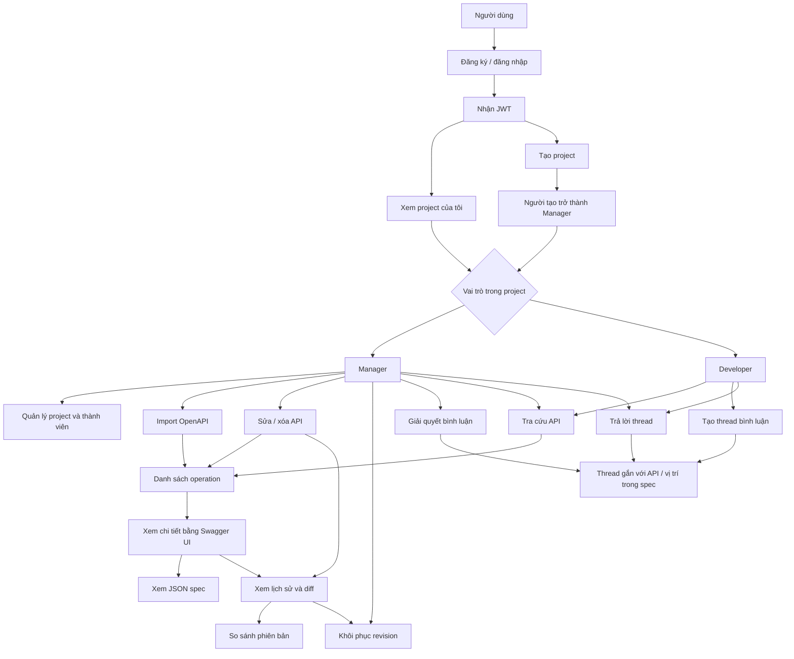
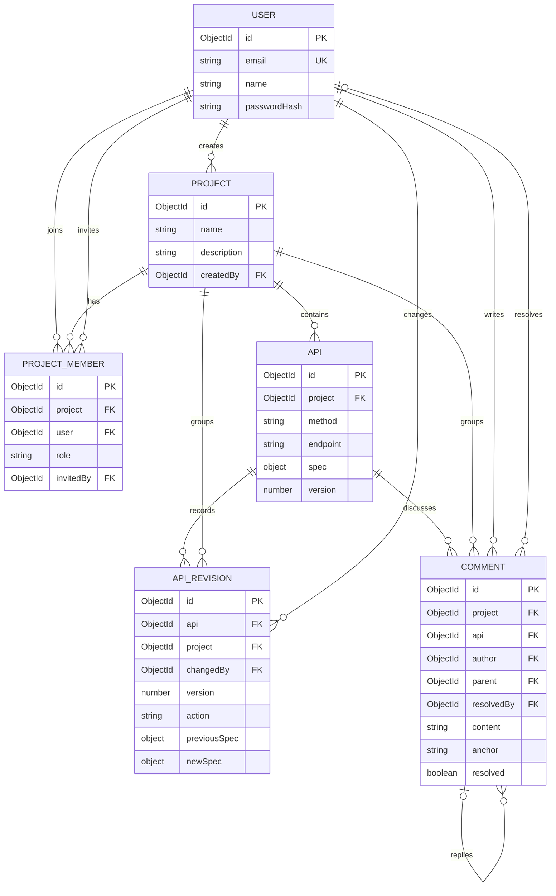
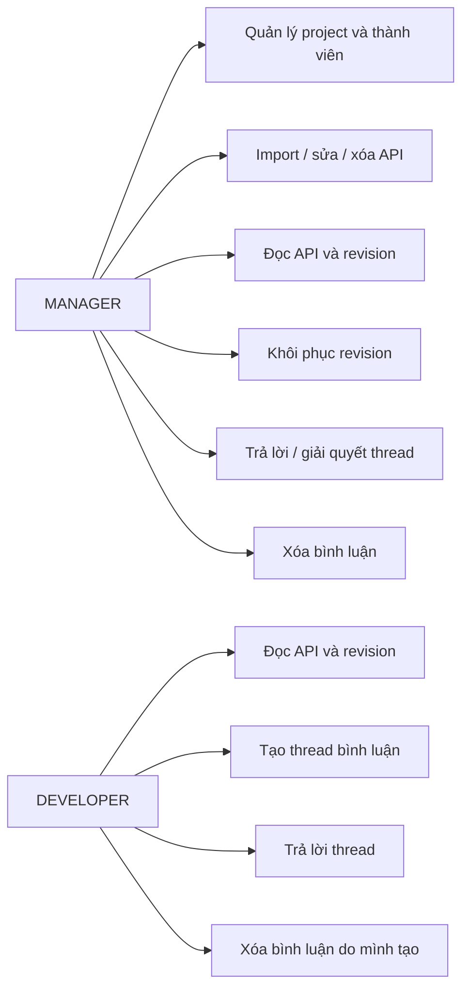

# API Portal

API Portal là ứng dụng quản lý tài liệu API theo project. Người dùng có thể tổ chức API theo nhóm, phân quyền thành viên, nhập tài liệu OpenAPI, xem lịch sử và so sánh thay đổi, khôi phục phiên bản cũ, và trao đổi bằng bình luận gắn với operation.

Repository gồm:

- **Backend:** Node.js, Express 5, MongoDB và Mongoose.
- **Frontend:** React 18, Vite, Tailwind CSS 4 và Radix UI.
- **API:** REST API phiên bản `v1`, đặt dưới prefix `/api/v1`.

## Mục lục

- [Sơ đồ chức năng](#sơ-đồ-chức-năng)
- [Công nghệ](#công-nghệ)
- [Yêu cầu](#yêu-cầu)
- [Cài đặt và chạy local](#cài-đặt-và-chạy-local)
- [Cấu hình môi trường](#cấu-hình-môi-trường)
- [Dữ liệu mẫu](#dữ-liệu-mẫu)
- [Kiểm thử](#kiểm-thử)
- [Cấu trúc dự án](#cấu-trúc-dự-án)
- [Mô hình dữ liệu](#mô-hình-dữ-liệu)
- [Xác thực và phân quyền](#xác-thực-và-phân-quyền)
- [REST API](#rest-api)
- [Định dạng request và response](#định-dạng-request-và-response)
- [Các luồng nghiệp vụ quan trọng](#các-luồng-nghiệp-vụ-quan-trọng)
- [Xử lý sự cố](#xử-lý-sự-cố)
- [Triển khai](#triển-khai)

## Sơ đồ chức năng



Các thao tác trong sơ đồ được kiểm soát theo vai trò của thành viên trong từng project. Xem ma trận chi tiết tại [Xác thực và phân quyền](#xác-thực-và-phân-quyền).

## Công nghệ

| Thành phần | Công nghệ |
|---|---|
| Runtime | Node.js 20 trở lên |
| Backend | Express 5, ES modules |
| Database | MongoDB, Mongoose 8 |
| Xác thực | JSON Web Token (HS256), bcryptjs |
| Kiểm tra đầu vào | Zod |
| Đọc và kiểm tra OpenAPI | Swagger Parser, YAML |
| Frontend | React 18, Vite 6 |
| UI | Tailwind CSS 4, Radix UI, Lucide |

## Yêu cầu

- Node.js `>=20` và npm.
- MongoDB có hỗ trợ **replica set**. MongoDB Atlas đáp ứng yêu cầu này; MongoDB local cần được khởi chạy dưới dạng replica set nếu muốn dùng các luồng transaction.
- Có quyền truy cập mạng từ máy chạy backend tới MongoDB.

Các thao tác tạo project, import/cập nhật/khôi phục API và xóa project dùng MongoDB transaction. MongoDB standalone không hỗ trợ các transaction này.

## Cài đặt và chạy local

Mở hai terminal tại thư mục gốc của repository. Backend và frontend được cài dependency riêng.

### 1. Cấu hình backend

Trong PowerShell:

```powershell
Copy-Item .env.example .env
```

Mở `.env` và cấu hình ít nhất `MONGODB_URI` cùng `JWT_SECRET`. Xem [Cấu hình môi trường](#cấu-hình-môi-trường).

Cài dependency và chạy backend:

```powershell
npm install
npm run dev
```

Backend mặc định chạy tại `http://localhost:3000`. Kiểm tra trạng thái bằng:

```powershell
Invoke-RestMethod http://localhost:3000/health
```

Khi database đã kết nối, kết quả có dạng:

```json
{
  "status": "ok",
  "db": true
}
```

Nếu database chưa sẵn sàng, endpoint trả HTTP `503` cùng trạng thái `degraded`.

### 2. Cấu hình và chạy frontend

Mở terminal thứ hai:

```powershell
Set-Location .\frontend
Copy-Item .env.example .env
npm install
npm run dev
```

Mở URL Vite in ra terminal, thường là `http://localhost:5173`. Frontend gọi API qua `/api/v1`; trong môi trường development, Vite proxy đường dẫn này tới backend `http://localhost:3000`. Cấu hình proxy bằng `API_PROXY_TARGET` nếu backend chạy ở host hoặc port khác.

Tạo bản build frontend:

```powershell
npm run build
```

Để xem bản build trên máy local:

```powershell
npm run preview
```

Các lệnh build/preview chạy trong thư mục `frontend`.

## Cấu hình môi trường

### Backend

Tạo file `.env` ở thư mục gốc dựa trên `.env.example`.

| Biến | Bắt buộc | Mặc định | Mô tả |
|---|---:|---|---|
| `NODE_ENV` | Không | `development` | Chỉ nhận `development`, `production` hoặc `test`. |
| `PORT` | Không | `3000` | Cổng HTTP của backend. |
| `MONGODB_URI` | Có | — | MongoDB connection string, cần chỉ rõ database. |
| `JWT_SECRET` | Có | — | Secret ký JWT, tối thiểu 32 ký tự. Hãy tạo secret riêng cho từng môi trường. |
| `JWT_EXPIRES_IN` | Không | `1d` | Thời hạn JWT, theo định dạng được thư viện `jsonwebtoken` hỗ trợ. |
| `CORS_ORIGINS` | Không | `http://localhost:5173` | Danh sách origin được phép, phân cách bằng dấu phẩy. |
| `BCRYPT_ROUNDS` | Không | `12` | Số vòng bcrypt, giới hạn từ 10 đến 15. |
| `DNS_SERVERS` | Không | — | Danh sách DNS server, phân cách bằng dấu phẩy; chỉ đặt khi môi trường cần DNS tùy chỉnh. |

Ví dụ tạo secret ngẫu nhiên bằng Node.js:

```powershell
node -e "console.log(require('node:crypto').randomBytes(48).toString('hex'))"
```

Ví dụ connection string Atlas:

```text
mongodb+srv://<username>:<password>@<cluster-host>/api_portal?retryWrites=true&w=majority
```

Thay thông tin placeholder bằng thông tin database của bạn; không đưa thông tin xác thực thật vào Git. Trên MongoDB Atlas, tạo database user, cho phép IP của máy chạy backend trong Network Access và dùng connection string từ mục **Connect → Drivers**.

Khi frontend chạy ở origin khác, thêm origin đó vào `CORS_ORIGINS`, ví dụ:

```dotenv
CORS_ORIGINS=http://localhost:5173,https://portal.example.com
```

### Frontend

File `frontend/.env.example`:

| Biến | Mặc định | Mô tả |
|---|---|---|
| `VITE_API_URL` | `/api/v1` | Base URL API mà frontend sử dụng. Giữ giá trị tương đối khi đặt reverse proxy cùng origin. |
| `API_PROXY_TARGET` | `http://localhost:3000` | Backend target cho proxy của Vite khi chạy development server. |

Nếu triển khai frontend khác origin backend và không dùng reverse proxy cùng origin, đặt `VITE_API_URL` thành URL API đầy đủ và cho phép origin frontend trong `CORS_ORIGINS` của backend.

## Dữ liệu mẫu

Seed tạo hoặc cập nhật hai tài khoản và project `Demo Project`, sau đó import bộ API Petstore mẫu. Lệnh seed kết nối tới database được cấu hình trong `.env`:

```powershell
npm run seed
```

Tài khoản mặc định chỉ dành cho development:

| Vai trò | Email | Mật khẩu |
|---|---|---|
| `MANAGER` | `manager@example.com` | `Manager@123456` |
| `DEVELOPER` | `developer@example.com` | `Developer@123456` |

Có thể đổi email và mật khẩu seed bằng các biến sau trong `.env`:

```dotenv
SEED_MANAGER_EMAIL=manager@example.com
SEED_MANAGER_PASSWORD=Manager@123456
SEED_DEVELOPER_EMAIL=developer@example.com
SEED_DEVELOPER_PASSWORD=Developer@123456
```

Chạy lại seed sẽ đặt mật khẩu tài khoản mẫu về giá trị cấu hình hiện tại và đồng bộ quyền thành viên. Seed từ chối chạy khi `NODE_ENV=production`, trừ khi chủ động truyền cờ `--force` cho script.

**Cảnh báo:** `npm run seed:reset` xóa project mẫu do tài khoản Manager seed tạo, cùng các tài khoản seed và membership của họ. Chỉ chạy trên database development/test phù hợp:

```powershell
npm run seed:reset
```

## Kiểm thử

Chạy unit test backend từ thư mục gốc:

```powershell
npm test
```

Test hiện có tập trung vào parser OpenAPI và logic tạo diff spec; các test này không cần kết nối MongoDB.

Frontend chưa khai báo script test trong `frontend/package.json`. Ngoài ra, `package.json` ở thư mục gốc có khai báo `npm run e2e` và `npm run test:live`, nhưng các file `scripts/e2e.mjs` và `scripts/live.mjs` hiện không có trong repository; vì vậy hai lệnh này chưa thể chạy.

## Cấu trúc dự án

```text
.
├── src/
│   ├── app.js                    # Middleware, health check và mount API
│   ├── server.js                 # Kết nối DB, khởi chạy và đóng server
│   ├── config/
│   │   ├── db.js                 # Kết nối MongoDB
│   │   └── env.js                # Đọc và kiểm tra biến môi trường
│   ├── constants/
│   │   ├── permissions.js        # Ma trận quyền project-level
│   │   └── roles.js              # Các vai trò
│   ├── middlewares/
│   │   ├── authenticate.js       # Xác thực JWT
│   │   ├── errorHandler.js       # Chuẩn hóa lỗi HTTP
│   │   ├── projectRoleGuard.js   # Kiểm tra membership và quyền
│   │   └── validate.js           # Kiểm tra body, params, query bằng Zod
│   ├── models/                   # Mongoose models
│   ├── modules/                  # Routes và service theo domain
│   │   ├── apis/
│   │   ├── auth/
│   │   ├── comments/
│   │   ├── members/
│   │   ├── projects/
│   │   ├── revisions/
│   │   └── users/
│   ├── routes/index.js           # Route auth, users, projects và rate limit
│   └── utils/
│       ├── openapi.js            # Parse, validate và tách operation
│       ├── specDiff.js           # So sánh hai JSON spec
│       └── transaction.js        # Hỗ trợ transaction
├── test/                         # Unit test backend
├── scripts/
│   ├── seed.js                   # Tạo hoặc xóa dữ liệu mẫu
│   └── seedData.js               # Tài khoản, project và OpenAPI mẫu
├── frontend/
│   ├── src/
│   │   ├── App.jsx               # Giao diện ứng dụng
│   │   ├── components/ui/        # Các primitive UI dùng lại
│   │   └── main.jsx              # Entry point React
│   ├── .env.example
│   └── vite.config.js            # Vite, React, Tailwind và API proxy
├── .env.example
└── package.json
```

## Mô hình dữ liệu



`PROJECT_MEMBER` là collection liên kết user với project và lưu role. Xóa project sẽ xóa các API, revision, bình luận và membership thuộc project đó trong transaction; xóa API cũng xóa revision và bình luận liên quan. Đây là xóa cứng, không phải soft-delete.

## Xác thực và phân quyền

### JWT

Đăng ký và đăng nhập trả về `accessToken`. Gửi token trong header cho các endpoint cần xác thực:

```http
Authorization: Bearer <accessToken>
```

Token được ký bằng HS256; thời hạn mặc định là một ngày. Hiện chưa có refresh token.

### Vai trò trong project



Người không thuộc project nhận `404` để không tiết lộ project có tồn tại hay không. Thành viên có role nhưng không đủ quyền nhận `403`.

## REST API

Base URL local:

```text
http://localhost:3000/api/v1
```

Ngoại lệ: health check là `GET http://localhost:3000/health`, không nằm dưới `/api/v1`.

Trong các bảng dưới đây, `Auth` nghĩa là cần Bearer token; các quyền như `Member`, `Manager` và `Developer` áp dụng thêm trên project tương ứng.

### Health và tài khoản

| Method | Đường dẫn | Quyền | Mô tả |
|---|---|---|---|
| `GET` | `/health` | Công khai | Trạng thái backend và kết nối database. |
| `POST` | `/auth/register` | Công khai | Tạo tài khoản; body gồm `email`, `name`, `password`. Mật khẩu tối thiểu 8 ký tự. |
| `POST` | `/auth/login` | Công khai | Đăng nhập; body gồm `email`, `password`. |
| `GET` | `/users/me` | Auth | Thông tin người dùng hiện tại. |
| `GET` | `/users/me/projects` | Auth | Danh sách project của người dùng, kèm role. |

### Project và thành viên

| Method | Đường dẫn | Quyền | Mô tả |
|---|---|---|---|
| `POST` | `/projects` | Auth | Tạo project; body gồm `name` và `description` tùy chọn. Người tạo thành Manager. |
| `GET` | `/projects/:projectId` | Member | Xem project và role hiện tại. |
| `PATCH` | `/projects/:projectId` | Manager | Sửa `name` và/hoặc `description`. Cần gửi ít nhất một trường. |
| `DELETE` | `/projects/:projectId` | Manager | Xóa project và dữ liệu liên quan. Trả `204`. |
| `GET` | `/projects/:projectId/members` | Manager | Danh sách thành viên. |
| `POST` | `/projects/:projectId/members` | Manager | Thêm thành viên đã đăng ký bằng `email`; `role` tùy chọn, mặc định `DEVELOPER`. |
| `PATCH` | `/projects/:projectId/members/:userId` | Manager | Đổi role thành `MANAGER` hoặc `DEVELOPER`. |
| `DELETE` | `/projects/:projectId/members/:userId` | Manager | Xóa membership. Trả `204`. |

### API và OpenAPI

| Method | Đường dẫn | Quyền | Mô tả |
|---|---|---|---|
| `GET` | `/projects/:projectId/apis` | Member | Danh sách API; hỗ trợ `q`, `method`, `tag`, `page`, `limit`. Danh sách không trả toàn bộ spec. |
| `POST` | `/projects/:projectId/apis/import` | Manager | Import tài liệu OpenAPI. |
| `GET` | `/projects/:projectId/apis/:apiId` | Member | Xem API cùng spec. |
| `PUT` | `/projects/:projectId/apis/:apiId` | Manager | Thay operation spec; bắt buộc có `spec` và `commitMessage`; `baseVersion` tùy chọn. |
| `DELETE` | `/projects/:projectId/apis/:apiId` | Manager | Xóa API cùng revision và bình luận liên quan. Trả `204`. |

Import nhận đúng **một** trong hai dạng:

```json
{
  "content": "openapi: 3.0.3\ninfo:\n  title: Example API\n  version: '1.0.0'\npaths:\n  /health:\n    get:\n      summary: Health check\n      responses:\n        '200':\n          description: Service is healthy",
  "commitMessage": "Import tài liệu ban đầu"
}
```

Hoặc:

```json
{
  "spec": {
    "openapi": "3.0.3",
    "info": { "title": "Example", "version": "1.0" },
    "paths": {}
  },
  "commitMessage": "Import tài liệu ban đầu"
}
```

Giới hạn mỗi lần import là 1.000 operation; JSON request body tối đa 10 MB. `$ref` nội bộ được dereference. `$ref` tới file hoặc URL bên ngoài không được tải. Import operation mới sẽ tạo API ở version 1; operation đã tồn tại được cập nhật và ghi revision nếu spec khác; spec giống hệt được giữ nguyên.

### Revision

Thay `:apiId` bằng API ID. Các đường dẫn revision bắt đầu từ `/projects/:projectId/apis/:apiId/revisions`.

| Method | Đường dẫn | Quyền | Mô tả |
|---|---|---|---|
| `GET` | `/projects/:projectId/apis/:apiId/revisions` | Member | Timeline mới nhất trước; hỗ trợ `page`, `limit`, không tải spec đầy đủ. |
| `GET` | `/projects/:projectId/apis/:apiId/revisions/compare?from=1&to=2` | Member | So sánh spec sau hai version. |
| `GET` | `/projects/:projectId/apis/:apiId/revisions/:revisionId` | Member | Chi tiết revision và diff với spec trước đó. |
| `POST` | `/projects/:projectId/apis/:apiId/revisions/:revisionId/restore` | Manager | Khôi phục spec sau revision đã chọn; body có thể gồm `commitMessage`. |

Restore không xóa hoặc sửa lịch sử cũ; thao tác tạo revision mới với action `RESTORE`. Không thể restore khi spec hiện tại đã giống spec đích.

### Bình luận

Các đường dẫn bình luận bắt đầu từ `/projects/:projectId/apis/:apiId/comments`.

| Method | Đường dẫn | Quyền | Mô tả |
|---|---|---|---|
| `GET` | `/projects/:projectId/apis/:apiId/comments` | Member | Danh sách thread mới nhất trước; hỗ trợ `resolved=true|false`, `page`, `limit`; replies được trả kèm thread. |
| `POST` | `/projects/:projectId/apis/:apiId/comments` | Developer | Tạo thread; body gồm `content` và `anchor` tùy chọn. |
| `POST` | `/projects/:projectId/apis/:apiId/comments/:commentId/replies` | Member | Trả lời thread; body gồm `content`. |
| `PATCH` | `/projects/:projectId/apis/:apiId/comments/:commentId/resolve` | Manager | Đánh dấu đã giải quyết hoặc mở lại; body gồm `{"resolved": true}` hoặc `{"resolved": false}`. |
| `DELETE` | `/projects/:projectId/apis/:apiId/comments/:commentId` | Tác giả hoặc Manager | Xóa bình luận; xóa thread gốc cũng xóa các reply. Trả `204`. |

`anchor` là chuỗi định vị tùy ý trong spec, ví dụ `/responses/404`. Reply chỉ hỗ trợ một cấp: không thể trả lời một reply.

## Định dạng request và response

- Request body phải là JSON, trừ `content` trong API import có thể chứa văn bản JSON hoặc YAML.
- Các đầu vào body, query và ID được kiểm tra bằng schema; ID MongoDB phải là ObjectId 24 ký tự hex.
- Phân trang mặc định là `page=1`, `limit=20`; `limit` hợp lệ từ 1 đến 100.
- HTTP method của filter API không phân biệt chữ hoa/thường và được chuẩn hóa thành chữ hoa.
- Route trả dữ liệu thông thường theo dạng:

```json
{
  "data": {},
  "meta": {
    "page": 1,
    "limit": 20,
    "total": 42,
    "totalPages": 3
  }
}
```

`meta` chỉ có trong các endpoint phân trang. Endpoint không phân trang thường chỉ trả `{ "data": ... }`. Endpoint xóa thành công trả HTTP `204` và không có response body.

Lỗi có định dạng:

```json
{
  "error": {
    "code": "VALIDATION_ERROR",
    "message": "Dữ liệu không hợp lệ",
    "details": []
  }
}
```

Các status thường gặp gồm:

| HTTP status | Ý nghĩa |
|---|---|
| `400` | Request hoặc dữ liệu không hợp lệ. |
| `401` | Thiếu token, token sai/hết hạn hoặc đăng nhập thất bại. |
| `403` | Thành viên không có quyền thực hiện thao tác. |
| `404` | Không tìm thấy tài nguyên/route hoặc user không thuộc project. |
| `409` | Xung đột dữ liệu, ví dụ email trùng hoặc API đã được cập nhật bởi người khác. |
| `413` | Request body vượt quá giới hạn. |
| `429` | Vượt giới hạn request. |
| `500` | Lỗi hệ thống; stack chỉ được trả trong môi trường không phải production. |

Rate limit mặc định cho toàn bộ `/api/v1` là 1.000 request mỗi 15 phút trên mỗi IP; riêng đăng ký/đăng nhập là 30 request mỗi 15 phút trên mỗi IP. Backend bật `trust proxy` cho môi trường chạy sau reverse proxy; cấu hình số lượng proxy tin cậy phù hợp với hạ tầng triển khai.

## Các luồng nghiệp vụ quan trọng

### Import OpenAPI

1. Backend parse JSON/YAML và validate tài liệu.
2. Mỗi `method + endpoint` trong `paths` trở thành một API trong project.
3. Parameter cấp path được gộp với parameter cấp operation; parameter cấp operation ghi đè khi trùng `name` và `in`.
4. `$ref` nội bộ được dereference; `servers` và `security` được kế thừa từ operation, path hoặc document theo thứ tự phù hợp.
5. Tạo mới, cập nhật và ghi revision chạy trong cùng transaction. Nếu transaction thất bại, các thay đổi import không được ghi một phần.

### Sửa API và optimistic locking

Mỗi lần thay đổi spec thành công làm tăng `Api.version` và tạo một revision trong cùng transaction. Client có thể gửi `baseVersion` là version đang xem. Nếu version hiện tại khác `baseVersion`, backend trả `409 Conflict` thay vì âm thầm ghi đè thay đổi mới hơn.

`PUT` chỉ chấp nhận operation spec có trường `responses` và commit message không rỗng. Nếu spec mới không thay đổi so với hiện tại, backend trả lỗi `400`.

### Diff và restore

Diff trả các thay đổi `add`, `remove`, `replace` cùng `path` theo JSON Pointer. Object được so theo key; array được so theo index. Compare nhận số version, còn restore nhận revision ID và khôi phục spec sau version đó.

### Xóa dữ liệu

Project, API và comment bị xóa là xóa cứng. Xóa project sẽ xóa toàn bộ dữ liệu thuộc project; xóa API sẽ xóa revision và comment của API. Hãy cân nhắc backup database trước khi thao tác trên dữ liệu quan trọng.

## Ví dụ sử dụng API bằng PowerShell

Ví dụ sau dùng tài khoản seed. Chạy seed trước và khởi động backend:

```powershell
$baseUrl = "http://localhost:3000/api/v1"

$loginBody = @{
  email = "manager@example.com"
  password = "Manager@123456"
} | ConvertTo-Json

$login = Invoke-RestMethod `
  -Method Post `
  -Uri "$baseUrl/auth/login" `
  -ContentType "application/json" `
  -Body $loginBody

$headers = @{
  Authorization = "Bearer $($login.data.accessToken)"
}

$projects = Invoke-RestMethod `
  -Method Get `
  -Uri "$baseUrl/users/me/projects" `
  -Headers $headers

$projects.data | Select-Object name, role, id
```

Lấy danh sách API của project đầu tiên:

```powershell
$projectId = $projects.data[0].id
$apis = Invoke-RestMethod `
  -Method Get `
  -Uri "$baseUrl/projects/$projectId/apis?page=1&limit=20" `
  -Headers $headers

$apis.data | Select-Object method, endpoint, summary, version
```

Đăng nhập bằng tài khoản Developer để tạo thread bình luận; Manager không có quyền tạo thread theo ma trận quyền hiện tại.

## Xử lý sự cố

### Backend không khởi động vì cấu hình môi trường

Kiểm tra `.env` ở thư mục gốc, đặc biệt `MONGODB_URI` và `JWT_SECRET`. `JWT_SECRET` phải có ít nhất 32 ký tự; `NODE_ENV` chỉ nhận một trong ba giá trị `development`, `production`, `test`.

### Không kết nối được MongoDB

- Kiểm tra username/password và tên database trong `MONGODB_URI`.
- Với Atlas, thêm IP hiện tại của máy chạy backend vào Network Access.
- Kiểm tra DNS/network nếu hostname `mongodb+srv` không phân giải; có thể cấu hình `DNS_SERVERS` khi môi trường yêu cầu.
- Đảm bảo MongoDB hỗ trợ replica set vì một số thao tác sử dụng transaction.

### Frontend không gọi được backend

- Xác nhận backend đang chạy và `GET /health` trả `200`.
- Khi chạy Vite, kiểm tra `API_PROXY_TARGET` có trỏ đúng tới backend không; sau khi đổi biến môi trường hãy khởi động lại Vite.
- Khi gọi backend khác origin hoặc triển khai trực tiếp, đặt đúng `VITE_API_URL` và thêm origin frontend vào `CORS_ORIGINS`.

### Nhận `403` hoặc `404` trên route project

`403` thường có nghĩa tài khoản đã là thành viên nhưng role hiện tại không đủ quyền. `404` có thể là project/API không tồn tại, ID sai định dạng hoặc tài khoản chưa là thành viên của project.

### Nhận `409` khi cập nhật API

Một thay đổi khác đã tăng version sau khi client tải API. Tải lại API, cập nhật thay đổi dựa trên spec mới nhất rồi gửi lại request với `baseVersion` mới.

## Triển khai

- Chạy backend bằng `npm start`; đặt `NODE_ENV=production` và cung cấp đầy đủ environment variables qua hệ thống quản lý cấu hình của môi trường triển khai.
- Build frontend bằng `npm run build` trong thư mục `frontend`; phục vụ nội dung trong `frontend/dist` qua static hosting hoặc web server.
- Cấu hình reverse proxy để phục vụ frontend và chuyển tiếp `/api/v1` tới backend, hoặc cấu hình `VITE_API_URL` cùng `CORS_ORIGINS` khi frontend và backend ở origin khác nhau.
- Dùng MongoDB replica set, bật TLS khi phù hợp, giới hạn quyền truy cập mạng/database, và không dùng tài khoản seed mặc định ngoài môi trường development.
- Endpoint `/health` trả `200` khi kết nối MongoDB hoạt động và `503` khi database chưa sẵn sàng; có thể dùng endpoint này cho health check.
- Backend đặt giới hạn JSON body 10 MB để hỗ trợ import OpenAPI. Điều chỉnh giới hạn tại `src/app.js` nếu yêu cầu vận hành thay đổi và cần đánh giá tương ứng về tải/tài nguyên.

## Lệnh thường dùng

Chạy tại thư mục gốc:

| Lệnh | Tác dụng |
|---|---|
| `npm run dev` | Chạy backend ở chế độ watch. |
| `npm start` | Chạy backend. |
| `npm test` | Chạy unit test backend. |
| `npm run seed` | Tạo/cập nhật dữ liệu mẫu. |
| `npm run seed:reset` | Xóa dữ liệu seed. |

Chạy tại thư mục `frontend`:

| Lệnh | Tác dụng |
|---|---|
| `npm run dev` | Chạy Vite development server. |
| `npm run build` | Build frontend vào `dist/`. |
| `npm run preview` | Preview bản build local. |
